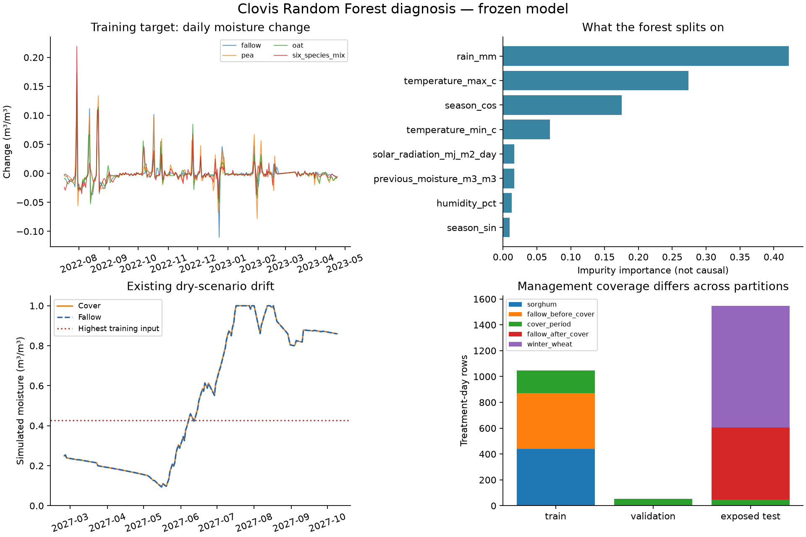

# Clovis model diagnosis and repair plan

The requested `ml-debugging`, `model-evaluation`, and `exploratory-data-analysis` skills were applied to the frozen model on 15 November 2026. Experiment tracking was also used for the training-only sanity check. The saved production-candidate model, preprocessing, split, and prior selection were not changed.

**The main problems are training coverage, a target-definition mismatch, very weak use of crop-management inputs, and unstable recursive extrapolation.** The evidence does not justify abandoning Random Forest generally or claiming that changing tree settings alone will fix the recommendation system.



## What the three skills established

### Exploratory data analysis: the training sample is narrower than the application

Descriptive EDA used training rows only. Existing exposed test results were used separately for postmortem error/coverage analysis; they are not a fresh validation set.

| Training coverage | Result |
| --- | ---: |
| Treatment-day examples | 1,048 |
| Distinct dates | 262 |
| Sorghum dates | 110 |
| Pre-cover fallow dates | 108 |
| Cover-period dates | 44 |
| Post-termination dates | **0** |
| Following-wheat dates | **0** |
| Eligible irrigated dates | **1**: 11 August 2022 |
| Duplicate date/treatment keys | 0 |

The four treatment readings on a date share the same weather. They do not constitute four independent weather events. The cover-planting irrigation occurs within an excluded sensor gap; it does not appear as a usable irrigated training pair. Thus there are only four irrigated training rows, all from one event.

The `days_since_cover_termination` feature is always -1 during training. It cannot teach the model a response after termination. In the exposed test, 1,500/1,548 rows belong to management phases missing from training. Crop age also exceeds the training range on all non-fallow validation rows.

Training targets and model features are finite after the existing preparation. Nullable management ages are intentional and consistently encoded as -1. The feature allowlist excludes current moisture and the target, and the numeric correlation scan found no correlation above 0.95 with the change target. These checks found no obvious target-leakage or duplicate-key defect; they cannot rule out every possible source-data issue.

### Measurement semantics: daily average, not end-of-day moisture

The [source study](https://acsess.onlinelibrary.wiley.com/doi/10.1002/vzj2.70077) describes daily averages derived from five-minute observations. It also reports interpolation around field-operation gaps and emphasizes recent moisture/water-input history in its forecasting setup. We independently checked the daily aggregation using training dates.

Across **1,048 training treatment-days**:

- Daily CSV value versus mean of valid five-minute readings: MAE **0.000000000249 m3/m3**.
- Daily CSV value versus the last valid five-minute reading: MAE **0.006526 m3/m3**.

The near-exact agreement confirms daily-mean targets. Our earlier end-of-day description was incorrect. The fitted numerical target is the change between successive daily means, not the change between evening sensor readings. Feeding an instantaneous sensor observation into a model trained on daily averages introduces another mismatch.

Most training series-days have 288 valid readings, but some have fewer, down to 11. A daily mean over a partial day may not be comparable to a full-day mean. This is a data-quality issue to investigate and document; no new exclusion was chosen using exposed test outcomes. The source does not provide a complete per-cell mask distinguishing original and interpolated values.

**Repair:** version the target/request semantics explicitly as daily-mean moisture. If the product needs end-of-day state instead, construct that target from the original timestamps, audit day completeness and sensor gaps, and train/evaluate a separate version. Do not merely relabel the existing model as an end-of-day predictor.

### ML debugging: the software can learn, but this forest barely uses management

A deliberately unrestricted single-tree forest memorized the first 64 training rows with MAE **1.17e-17 m3/m3**. That model was scored only on the same batch, saved as a diagnostic artifact, and never promoted or evaluated on held-out data. This is a wiring/capacity sanity check, not evidence of generalization. Neural-network learning-rate or gradient checks do not apply to this Random Forest.

The original shallow forest also improves on persistence within its training data:

| Cohort | Persistence MAE | Frozen model MAE |
| --- | ---: | ---: |
| Training, in sample | 0.009724 | **0.007653** |
| Original validation | **0.001924** | 0.002559 |
| Exposed held-out test | **0.011319** | 0.016328 |

Training improvement is approximately 21%; it reverses outside training. This supports a generalization/coverage diagnosis rather than a complete failure to fit labels. It does not distinguish every contribution of capacity, noise, and feature choice without controlled experiments.

Direct inspection of all 150 trees found:

| Original feature | Impurity importance | Split nodes |
| --- | ---: | ---: |
| Rain | 42.23% | 185 |
| Maximum temperature | 27.38% | 224 |
| Seasonal cosine | 17.51% | 196 |
| Previous moisture | 1.64% | 170 |
| Treatment | **0.146%** | **15** |
| Irrigation | **0%** | **0** |
| Management phase | **0%** | **0** |
| Cover-active flag | **0%** | **0** |
| Days since planting | **0%** | **0** |
| Days since termination | **0%** | **0** |

These are fitted-model diagnostics, not physical or causal feature contributions. Having a crop name in a payload does not mean the forest has learned a useful crop-water response.

The single irrigated date gives only four training examples, while the forest requires at least ten samples per leaf. An irrigation-only branch cannot isolate that event while meeting that leaf-size requirement. Lowering the limit could allow the split, but would not create independent irrigation events or validate a general response. More trees alone would not repair that missing evidence.

### Recursive drift: the learned change stops adapting beyond its training range

The highest previous-moisture value in training is **0.427120486**. Holding the weather and management inputs fixed for the largest training rain day (32.26 mm), the forest predicts:

| Previous moisture | Predicted daily change |
| --- | ---: |
| 0.4371 | +0.060454 |
| 0.6000 | +0.060454 |
| 0.9000 | +0.060454 |

Above the trained moisture range, those inputs reach identical learned leaves. The model therefore does not learn an increasingly strong drainage/loss response there. In the existing dry historical scenario, predicted water first exceeds the training maximum on 8 June 2027 and first clips at 1 on 17 July. It spends 123 simulated days above the training maximum. The other weather cases also drift and clip.

This explains how small one-day changes can accumulate into unrealistic seasonal water levels. Clipping at 1 bounds the arithmetic; it does not restore hydrological consistency. It can also erase earlier cover/fallow differences, as observed in the identical final-week outputs.

**Repair:** evaluate short horizons separately and stop presenting an unconstrained seasonal rollout as a recommendation engine. A direct multi-day target or a model that corrects a documented water balance are testable alternatives. Neither has been validated here. Arbitrarily clamping predictions to the training maximum or a guessed soil limit would conceal the problem.

### Model evaluation: the existing validation does not represent the seasonal task

The original validation contains only 13 dates, all in the cover period. It has no 30-day contiguous window and cannot establish seasonal behavior. The test is much longer but predominantly contains phases absent from training. This split is useful as a stress test of extrapolation; it is not sufficient evidence for a general cover recommendation.

A paired moving-block bootstrap of the existing held-out errors averages treatments within each date, then resamples 14-day contiguous blocks without crossing gaps (1,000 replicates; seed 42). Model absolute error minus persistence absolute error is:

- Mean: **+0.005009 m3/m3**.
- Conditional 95% interval: **+0.002676 to +0.008155 m3/m3**.

Positive values mean worse model error. This supports the observed ranking within this dataset, while accounting partly for date dependence. It does not quantify uncertainty across independent locations/seasons, causal crop effects, or recommendations. The test is already exposed and cannot be reused as an untouched test after repair.

## What remains a hypothesis

The present model uses only one previous moisture value and target-day weather. It lacks preceding-day rain/irrigation and multi-day moisture trends. Adding recent history is a reasonable candidate repair, but its value must be demonstrated in a controlled experiment; it has not been established by this diagnosis.

Training station rain and NASA rain have same-date correlation **0.8425**. The source has 42 dates with positive rain versus 117 for NASA, counting any positive amount. This can reflect spatial aggregation, light precipitation, units/rounding, or day alignment. It does not prove a bad join. Source `Rain` units/aggregation and station timezone must be confirmed before substituting station rain or interpreting totals; no date shift was searched or selected. On-site weather should first be a diagnostic benchmark, because future deployment will not have future station observations.

The four plotted treatment channels and single cover season do not supply independent counterfactual outcome labels. Improving moisture accuracy would still not automatically validate a cover-versus-fallow yield or profit recommendation.

## Concrete repair sequence

1. **Fix the target contract first.** Choose daily-mean or end-of-day moisture. The existing data supports the former directly. Correct payload/response wording and initial-water requirements in a separately versioned contract. Audit partial-day measurements and interpolation provenance before changing labels.
2. **Define the next experiment around short-term moisture.** Start with one-day predictions; report 3/7-day behavior separately. Keep persistence as the required baseline. A longer horizon needs its own acceptance evidence.
3. **Add recent history as one controlled change.** Candidate inputs: the previous three daily moisture values, recent moisture trend, and preceding three days of rainfall/irrigation. Document exactly which values are observed, forecast, or supplied by a scenario. A single moisture number cannot silently become an invented three-day history.
4. **Version the temporal evaluation before fitting.** Keep all treatments on a date together. Use expanding chronological folds and document lookback/boundary rules. Report crop/phase/event coverage for each fold. Including later phases in training is reasonable for a new prototype, but cannot be claimed as independent verification against the same exposed observations.
5. **Then test forest capacity.** Compare the fixed forest with a small predeclared alternative only after feature/coverage repair. Separate changes to depth/leaf size from changes to features; record every experiment. Do not tune a long list against the exposed test.
6. **Require new evidence for seasonal advice.** Obtain another compatible cover season/site, including management and moisture observations. Until then, keep crop advice explicitly heuristic and recommendation readiness false. A documented water balance can be evaluated separately for the MVP; it is not automatically validated by the Random Forest's failure.

The next single implementation task should be **the versioned moisture target/history contract**, followed by its data pipeline. No replacement production model was built in this diagnostic task.

## Reproduce and inspect

```powershell
apps/api/.venv/Scripts/python.exe apps/api/app/ml/diagnose_clovis.py
apps/api/.venv/Scripts/python.exe -m unittest discover -s apps/api/tests -p "test*.py" -v
```

- Diagnosis protocol: `apps/api/app/ml/clovis_diagnostic_protocol.json`.
- Diagnostic MLflow run: `634ef776aaa148c5b584848461ebc334`.
- Output: `data/experiments/clovis_diagnostics/runs/20261115T061750014236Z-634ef776/`.
- `latest.json` in that experiment directory points to the completed run.
- Artifacts include training EDA, coverage and range checks, tree diagnostics, source aggregation audit, fixed-state probes, uncertainty results, PNG figure, source/code hashes, and a separate training-only sanity model.

The diagnostic model has no recommendation role. The original model SHA-256 remains `0ddf72d619dbf73079ec2e19dc4bd96f5cbb2700355eede7b002b74d8dabd62d`.

All **67 software tests passed**, including four new checks for training-only EDA, paired and reproducible date-block uncertainty, gap handling, and distinguishing daily means from last readings. The diagnostic figure was rendered and visually inspected. These checks verify the diagnostic implementation; they do not turn the existing model into a validated recommendation system.
