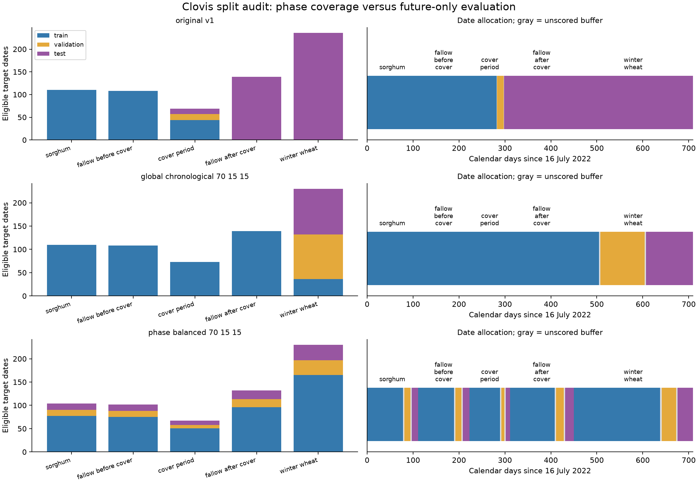

# Clovis split audit: phase coverage and training allocation

Follow-up: the user subsequently authorized [model evaluation on both allocations](CLOVIS_SPLIT_MODEL_EVALUATION.md). The text below records the allocation-only audit; its original no-training statements describe that stage.

The user questioned the original split and requested an audit using exploratory data analysis and other relevant skills. `exploratory-data-analysis` and `model-evaluation` were applied. This task checks structural coverage and prepares alternative date memberships; it does not train, replace, or score a model.

**The concern is correct.** The original split assigns only 39.6% of usable rows to training and 2.0% to validation. It also gives the model no training examples from two management phases that dominate its test. The split is a difficult extrapolation test, but a poor sole development/evaluation design for the intended all-phase MVP.

## Treatment and management phase are different categories

The treatment feature contains `fallow`, `pea`, `oat`, and `six_species_mix`. All four already appear in every original partition, with equal counts within each partition.

`sorghum`, `fallow_before_cover`, `cover_period`, `fallow_after_cover`, and `winter_wheat` are management phases. These occur in successive calendar intervals and are unevenly represented across the original partitions.

Original allocation, counting distinct usable target dates (four treatment examples per date):

| Management phase | Train | Validation | Exposed test |
| --- | ---: | ---: | ---: |
| Sorghum | 110 | 0 | 0 |
| Fallow before cover | 108 | 0 | 0 |
| Cover period | 44 | 13 | 12 |
| Fallow after cover | 0 | 0 | 139 |
| Winter wheat | 0 | 0 | 236 |
| **Total dates** | **262** | **13** | **387** |
| **Total treatment-day rows** | **1,048** | **52** | **1,548** |
| **Share of usable rows** | **39.6%** | **2.0%** | **58.5%** |

The raw dataset has 709 calendar days. Eligibility exclusions and consecutive-day requirements reduce the usable pair count. The percentage denominator above is 2,648 accepted examples, not every raw cell or calendar day.

## The key trade-off

The suggested category coverage is useful for learning a model across known phases. However, randomly stratifying individual rows would mix dates and place strongly related treatments from the same weather event in different partitions.

Even with date grouping, random time mixing does not measure forecasting into a wholly future period. Time-aware evaluation must preserve the direction of prediction. [Scikit-learn's cross-validation guidance](https://scikit-learn.org/stable/modules/cross_validation.html#time-series-split) discusses time-dependent observations and why ordinary shuffled evaluation can give misleading generalization estimates.

This dataset has one contiguous occurrence of each phase. A single global train-before-validation-before-test allocation therefore cannot put every phase in every partition. To test a genuinely future sorghum or cover phase after training on an earlier example of that phase, we need another compatible occurrence/season.

We prepared two explicit alternatives rather than concealing that constraint:

1. A global chronological 70/15/15 allocation for future-period evaluation.
2. A 70/15/15 allocation within each phase for exploratory historical phase coverage.

The second satisfies the requested category representation, but it must not be labeled a future-season validation.

## Candidate comparison

All candidate boundaries use dates and eligibility only. No moisture distributions, errors, or model scores were used to select cuts. Four treatments on the same date always have the same assignment.

| Allocation | Train rows | Validation rows | Test rows | Every phase in each partition? | Globally future-only? |
| --- | ---: | ---: | ---: | --- | --- |
| Original v1 | 1,048 | 52 | 1,548 | No | Yes |
| Global chronological 70/15/15 | 1,864 | 384 | 392 | No | Yes |
| Phase-balanced 70/15/15 | **1,856** | **328** | **356** | **Yes** | **No** |



The 70/15/15 proportions apply before three-day boundary buffers and subsequent eligibility checks. Floors, missing observations, phase transitions, and buffers change the final proportions. The phase-balanced usable allocation is **73.1% / 12.9% / 14.0%**. It increases training examples by 808, approximately 77%, compared with v1.

Balancing means allocating approximately the same proportion of each phase to each partition, while keeping its available sample size. It does not create equal numbers of observations for phases of different lengths, duplicate rare cover observations, or require giving one third of all data to each partition.

### Phase-balanced candidate: coverage

| Management phase | Train dates | Validation dates | Test dates |
| --- | ---: | ---: | ---: |
| Sorghum | 77 | 13 | 14 |
| Fallow before cover | 75 | 13 | 14 |
| Cover period | 51 | 7 | 9 |
| Fallow after cover | 96 | 17 | 19 |
| Winter wheat | 165 | 32 | 33 |
| **Total** | **464** | **82** | **89** |

Every phase/treatment combination is represented in all three partitions. There are still only seven cover validation dates and nine cover test dates. Most of the extra training examples come from broader management coverage; cover training increases from 44 to 51 dates. This cannot manufacture additional independent cover seasons or prove that the model will improve.

Within each phase, early observations go to training, the middle interval to validation, and the final interval to test. Three calendar days immediately after each preliminary cutoff are unscored buffers. No row-level random shuffling occurs.

| Phase | Preliminary training cutoff | Preliminary validation cutoff |
| --- | --- | --- |
| Sorghum | 1 October 2022 | 17 October 2022 |
| Fallow before cover | 20 January 2023 | 5 February 2023 |
| Cover period | 30 April 2023 | 10 May 2023 |
| Fallow after cover | 27 August 2023 | 16 September 2023 |
| Winter wheat | 13 April 2024 | 18 May 2024 |

The single pooled model would be fitted through April 2024 while some validation/test dates are in 2022 or 2023. In this candidate, 224 test rows and 200 validation rows precede or coincide with the latest training target. These are temporal inversions for a pooled forecast model, even though their exact moisture-date footprints are disjoint. The candidate is suitable only for a clearly labeled exploratory historical comparison.

### Global chronological candidate: coverage

Training targets run through **2 December 2023**; validation starts **6 December 2023** and runs through **10 March 2024**; test starts **14 March 2024**. Training includes all five phases. Validation and test contain only winter wheat.

This avoids unseen phases in the future wheat evaluation and uses about 70.6% of its accepted examples for training. It does not evaluate predictions during a new cover period. A stronger wheat score on this split would not validate cover recommendations.

## Buffer, history, and data integrity rules

The audit first reconstructs 2,664 eligible one-day examples, across 666 dates, without the old partition restrictions. This recovers pairs previously omitted solely because of the old purge dates/boundaries. Original source validity and sensor-window rules remain in effect; missing targets are not filled.

For each candidate target D, every moisture observation from D-lookback through D must be genuinely eligible. Context must belong to that partition or its preceding unscored buffer; it may not come from another non-gap partition. Using a measured buffer observation as past context is permitted for the candidate, while its target remains unscored. It is an explicit change from v1's rule requiring both pair endpoints to have the same partition label.

Three-day buffers make room for a possible three-day history pipeline. For the current one-day feature structure, the phase-balanced candidate has 1,856/328/356 examples. Requiring three real prior moisture days gives **1,808/328/356**. The latter removes more early training observations around missing histories and phase boundaries. It does not create the actual lag feature columns; that remains a later data-pipeline task.

The audit checks both target dates and all moisture context dates for shared footprints across train/validation/test. Footprints are disjoint for the candidates. This prevents exact reuse of target/context moisture dates across partitions; it does not establish statistical independence, remove all time dependence, or repair globally reversed chronology in the phase-balanced candidate.

All original protocol, split-manifest, and train/validation/test pair hashes remain unchanged. No saved model was loaded or fitted. Output membership files contain dates, treatment/phase identity, and context metadata, not moisture labels or new model features.

## Recommendation for the MVP

Use the **phase-balanced candidate as a separate, versioned development experiment** if the immediate question is whether a model with exposure to every observed phase can outperform persistence on reserved blocks of this historical sequence. It directly addresses the requested phase coverage, with a much larger training allocation.

Retain **global chronological evaluation** as a distinct future-period check, reporting exactly which phases it tests. Scores from the two designs answer different questions and should not be merged or compared as though they use identical cohorts.

The original data has already been exposed during diagnosis. Neither new allocation constitutes a newly untouched independent test, even though fitting and preprocessing can be restricted correctly inside its partitions. We need another compatible season/site for a convincing future cover recommendation test.

The next implementation task would materialize the chosen development allocation into a **new versioned feature dataset**, while correcting the daily-mean target contract. Then fit the same fixed Random Forest and persistence on that version, with all preprocessing fitted on its training data. Do not overwrite v1 or claim that the original model has been improved before measuring it.

## Reproduce and artifacts

```powershell
apps/api/.venv/Scripts/python.exe apps/api/app/ml/audit_clovis_splits.py
apps/api/.venv/Scripts/python.exe -m unittest discover -s apps/api/tests -p "test_audit_clovis_splits.py" -v
```

The fixed audit policy is `apps/api/app/ml/clovis_split_audit_protocol.json`. Default output: `data/analysis/clovis_split_audit_v1/`.

Artifacts include `results.json`, `provenance.json`, `split_comparison.png`, and one directory per variant containing:

- `date_assignments.csv`: every original calendar date's phase and partition.
- `eligible_target_membership.csv`: usable one-day target identities, history start dates, and buffer-context flags.
- `candidate_partitions.json`: explicit calendar intervals and cutoffs for review, labeled as allocation-only.

Six targeted tests passed. They verify original count reproduction, four-treatment date grouping, all-phase coverage, global chronology flags, three-day buffers and history, missing-observation handling, exact footprint disjointness, interval roundtripping, and independence of boundaries from valid target values. The chart was rendered and visually inspected.
