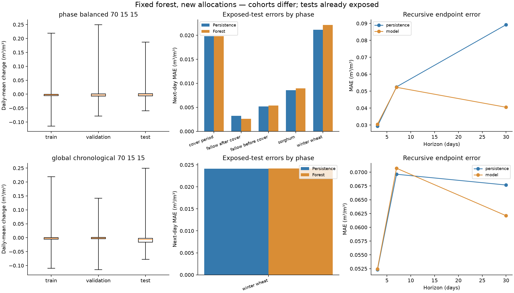

# Fixed Random Forest evaluation on the new split allocations

The user requested evaluation of the model and data behavior after the split audit. Two separate feature datasets were materialized from the audited memberships, then the same fixed Random Forest was fitted independently on each training partition. This experiment used `model-evaluation`, `exploratory-data-analysis`, `scikit-learn`, `sklearn-pipelines`, and `experiment-tracking` guidance.

**Both new forests are approximately at persistence performance for next-day moisture.** Validation gains are modest and do not carry into lower overall exposed-test MAE. Training phase coverage is now complete, but wetting events, sparse irrigation, and crop-specific response remain problems. Neither artifact was promoted.

## What was held fixed

- Random Forest: 150 trees, depth 4, minimum 10 samples per leaf, all features considered at each split, seed 42, one worker. The actual estimator defaults and environment are recorded with the run.
- Same 15 pre-encoding features, shared train/inference feature function, one-hot encoding, training-only scaler, and [-1] management-age convention.
- Target: change in **daily-average moisture at 5 cm**, not instantaneous/end-of-day moisture. Prediction adds that change to the previous daily average, with the existing [0,1] mathematical clipping and diagnostic flags.
- Same original sensor-validity and missing-target rules, cached NASA weather, and irrigation conversion.
- No new lag features, hyperparameter search, station-weather substitution, all-data refit, or test-based candidate selection.

Only the audited allocation and resulting training cohort changed. The numerical daily-mean target definition was already present in the source; its documentation is now explicit in the new dataset manifest and model metadata.

## Dataset and evaluation scopes

| Allocation | Training rows | Validation rows | Exposed-test rows | Interpretation |
| --- | ---: | ---: | ---: | --- |
| Phase-balanced 70/15/15 | 1,856 | 328 | 356 | Every phase appears in each partition; exploratory historical comparison with mixed global chronology. |
| Global chronological 70/15/15 | 1,864 | 384 | 392 | All phases in training; later validation/test contains winter wheat only. |

All treatments on a date remain together. Three-day unscored buffers and observed-context rules follow the [split audit](CLOVIS_SPLIT_AUDIT.md). Exact moisture target/history date footprints are disjoint across partitions, but that does not make the phase-balanced evaluation globally future-only or statistically independent.

Every observation belongs to the previously exposed original site/sequence. These are not fresh independent final tests. Compare each forest with persistence on its own cohort; the different absolute errors between allocations do not establish that one allocation produces a better model.

## Next-day results

MAE and RMSE use m3/m3; multiply by 100 for volumetric percentage points. Positive improvement means lower MAE than persistence on that same cohort.

| Allocation | Partition | Persistence MAE | Forest MAE | Improvement |
| --- | --- | ---: | ---: | ---: |
| Phase-balanced | Train | 0.008544 | 0.006954 | +18.6% |
| Phase-balanced | Validation | 0.018965 | 0.018340 | +3.3% |
| Phase-balanced | Exposed test | **0.012715** | 0.013031 | -2.5% |
| Chronological | Train | 0.008130 | 0.006919 | +14.9% |
| Chronological | Validation | 0.008174 | 0.007988 | +2.3% |
| Chronological | Exposed test | **0.024114** | 0.024177 | -0.3% |

Phase-balanced test RMSE is 0.027686; chronological test RMSE is 0.044126. Daily-change R2 is -0.0358 and +0.0022 respectively. High persistence in absolute water level therefore still does not translate into strong prediction of daily changes.

Both variants pass the earlier validation checks for per-treatment degradation, seven-day endpoint error, and no one-day/seven-day clipping. Both fail the predeclared requirement for at least 5% lower validation MAE. These are diagnostic checks; no promotion would be justified by them alone on exposed data.

Paired moving date-block bootstrap intervals for **test model absolute error minus persistence absolute error** (7-day contiguous blocks, 1,000 replicates, seed 42):

| Allocation | Mean difference | Conditional 95% interval |
| --- | ---: | --- |
| Phase-balanced | +0.000316 | -0.000869 to +0.002561 |
| Chronological | +0.000063 | -0.001653 to +0.002651 |

Both intervals cross zero. Within this exposed sequence, the test differences do not demonstrate a clear advantage for either forest over persistence. These intervals do not quantify uncertainty across independent seasons/sites or recommendations.



In the boxplots, whiskers show minimum/maximum values, not 1.5-IQR fences. The recursive horizons use different eligible rolling origins; the plotted curves are not a common-origin forecast-decay experiment.

## How the data behaves

### Phase coverage was repaired; water-event coverage is still sparse

All evaluated phases are now present in each model's training data; unseen-phase prediction counts are zero. This removes the original unseen-category condition for these cohorts.

However, the phase-balanced training set contains only **three irrigated dates**: 11 August 2022, 4 March 2024, and 3 April 2024. Its validation has three others and test has one. The chronological training set still contains only the August 2022 irrigation event; its five test irrigation dates are in April/May 2024. Complete phase labels do not imply complete coverage of water-input conditions.

### Training, validation, and test experience different moisture changes

| Allocation / partition | Daily-change standard deviation | Mean absolute daily change |
| --- | ---: | ---: |
| Phase-balanced train | 0.019356 | 0.008544 |
| Phase-balanced validation | 0.040842 | 0.018965 |
| Phase-balanced test | 0.027203 | 0.012715 |
| Chronological train | 0.019026 | 0.008130 |
| Chronological validation | 0.017859 | 0.008174 |
| Chronological test | 0.044174 | 0.024114 |

The mean absolute change is persistence's MAE by definition: persistence predicts zero change. This explains why its difficulty varies across cohorts even with identical prediction logic. Larger absolute MAE on another split is not automatically a model regression.

Within the phase-balanced cover phase specifically:

- Largest positive training change: **0.004713 m3/m3**.
- Largest positive validation change: **0.002049 m3/m3**.
- Largest positive exposed-test change: **0.186804 m3/m3**.

The held-out cover rise is about 40 times the largest positive cover-training change. The training/validation cover blocks are dominated by drying or small changes; test includes a much stronger recharge event. Balancing phase names did not balance the physical conditions occurring within those phases. Moving that particular known event into training just to improve the score would not establish generalization.

### Large errors are concentrated around abrupt wetting

Examples from the phase-balanced exposed-test prediction table:

| Target date / treatment | Measured daily-mean change | Forest change | Relevant recorded inputs |
| --- | ---: | ---: | --- |
| 17 May 2023 / pea | +0.186804 | +0.000018 | NASA rain 1.86 mm on target day, 4.22 mm on preceding day; no target-day irrigation. |
| 15 June 2024 / pea | +0.156147 | -0.000791 | NASA rain 11.25 mm on target day and 7.85 mm on preceding day. |
| 26 May 2024 / fallow | +0.107047 | -0.001738 | No target-day irrigation; the source records 45.72 mm irrigation on the preceding day. |

These examples support investigating recent water-input history and event/day alignment. They do not by themselves prove a causal explanation or establish that a three-day lag feature will solve the errors. The station rain and NASA rain also differ, and source rain units/day conventions need confirmation before any substitution. No time shift or new feature was selected by optimizing these test examples.

### What the phase-balanced forest learned

Its approximate impurity importances are rain 42.8%, seasonal cosine 16.4%, minimum temperature 15.8%, previous moisture 8.5%, management phase 4.0%, and irrigation 2.5%. Unlike the original model, it now uses irrigation and management-phase splits.

But **crop treatment has zero importance and zero split nodes** in this fitted forest. The cover-active flag is also unused. Planting/termination ages have small nonzero importance. For identical moisture, weather, and management-age inputs, changing pea to oat or six-species mix cannot change this particular forest's output, because no tree branches on that identity.

These are descriptions of the fitted model, not causal crop-water contributions. More phase coverage did not force the estimator to learn useful differences among cover species. It should not be presented as a model that can rank their agronomic benefit.

## Phase-balanced test errors by management phase

| Phase | Rows | Persistence MAE | Forest MAE |
| --- | ---: | ---: | ---: |
| Cover period | 36 | 0.019822 | 0.019798 |
| Fallow after cover | 76 | 0.003242 | **0.002620** |
| Fallow before cover | 56 | **0.005195** | 0.005386 |
| Sorghum | 56 | **0.008583** | 0.008962 |
| Winter wheat | 132 | **0.021174** | 0.022149 |

The equal-phase-average MAE is 0.011783 for the forest versus 0.011603 for persistence. That prevents the largest phase from being the sole explanation for the overall result. Cover-period MAE is essentially tied, with only nine correlated dates and no independent season.

## Recursive forecasts

Each rolling window starts from one measured previous daily average. All later states are predictions, with actual historical weather forwarded each day. No observed soil-moisture resets occur within a window.

| Allocation | Horizon | Windows | Persistence endpoint MAE | Forest endpoint MAE | Forest clipped steps |
| --- | ---: | ---: | ---: | ---: | ---: |
| Phase-balanced | 3 days | 316 | 0.029304 | 0.030471 | 0 |
| Phase-balanced | 7 days | 236 | 0.052538 | 0.052284 | 0 |
| Phase-balanced | 30 days | 16 | 0.089223 | 0.040517 | 0 |
| Chronological | 3 days | 380 | 0.052299 | 0.052440 | 0 |
| Chronological | 7 days | 364 | 0.069622 | 0.070713 | 0 |
| Chronological | 30 days | 272 | 0.067669 | 0.062103 | 0 |

There is no clipping in these evaluated windows. This does not establish that a new 228-day simulation would remain stable; that simulation was not evaluated in this experiment.

The apparent large 30-day improvement for the phase-balanced variant uses just **four overlapping start dates times four treatments**, all in winter wheat, because other held-out phase blocks are too short. It is not a 30-day cover-period or seasonal recommendation result. The chronological 30-day improvement also needs independent confirmation; neither variant has a clear next-day advantage and all observations were previously exposed.

## What to try next

The split audit addressed a real coverage problem, but reallocation alone did not establish useful improvement over persistence. The next controlled experiment should add **recent moisture and rain/irrigation history** while keeping this forest configuration fixed. Define history availability and sensor/day boundaries first, fit preprocessing only on the corresponding training rows, and report phase/event behavior rather than just aggregate MAE.

Do not introduce a new algorithm, tune tree settings, and change features in the same experiment. A station-versus-NASA timing/unit audit is a separate useful diagnostic, particularly around large recharge errors. Another compatible cover season remains necessary for stronger independent evaluation and crop recommendations.

## Artifacts, reproducibility, and verification

```powershell
apps/api/.venv/Scripts/python.exe apps/api/app/ml/evaluate_clovis_split_variants.py
apps/api/.venv/Scripts/python.exe -m unittest discover -s apps/api/tests -p "test*.py" -v
```

The fixed protocol is `apps/api/app/ml/clovis_split_evaluation_protocol.json`. Optional CLI arguments select a new dataset root (`--dataset-dir`) or experiment directory (`--experiment-dir`). Changed inputs or differing existing prepared tables are rejected; do not overwrite v1 or a frozen v2 dataset.

- Prepared datasets: `data/processed/clovis_split_features_v2/`, with one directory per variant, typed feature CSVs, copied memberships/assignments, and a manifest binding their hashes and daily-mean semantics.
- MLflow parent run: `fe1a767f455342ec9c7bbfe552d897a8`.
- Experiment output: `data/experiments/clovis_split_evaluation_v2/runs/20261115T064751287088Z-fe1a767f/`.
- Each variant has a separate child run, saved forest, readable metadata, results, and train/validation/test prediction CSVs for both methods.
- Parent artifacts include the predeclared protocol, full results, findings, figure, versions, code/source hashes, and dataset manifest. Scikit-learn runtime: **1.9.1**; remaining package versions are in provenance.

All **78 software tests passed**, including five new tests for membership/weather integrity, exact audited counts, target semantics, protected original paths, reproducible dataset preparation, tampering rejection, small fixed-forest fitting, training-only scaling, no evaluation-time refit, and serialization parity. The plot was visually inspected.

The original model and its selection pointer remain unchanged. The new pipeline artifacts are exploratory; recommendation readiness is false, and they are not wired into FastAPI or the historical seasonal simulator.
